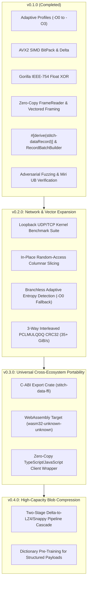

# Compact Binary Protocol (stitch-data) — Strategic Roadmap

## Overview & Vision

Compact Binary Protocol (stitch-data) is engineered under the **Scrooge Systems
Mindset**: mechanical sympathy, zero allocations on hot paths, 64-byte cache
alignment, monomorphic compile-time traversal, and empirical hardware
validation.

This document outlines the strategic engineering roadmap across completed
milestones, current release capabilities, and the tactical plan to close
non-conceptual gaps against FlatBuffers, Cap'n Proto, Protobuf, Zstandard,
and raw kernel sockets.

---

## Milestone Status Summary

| Version | Area | Status | Deliverables |
| :--- | :--- | :--- | :--- |
| **v0.1.0** | Core & SIMD | **DONE** | RFC v1.1, Derive, AVX2 |
| **v0.2.0** | I/O & Access | **TODO** | Loopback UDP, In-Place |
| **v0.3.0** | FFI & Web | **TODO** | `stitch-data-ffi`, WebAssembly |
| **v0.4.0** | Cascades | **TODO** | Delta -> LZ4 Pipeline |

---

## Completed: v0.1.0 — High-Performance Foundation

- [x] **Adaptive Optimization Profiles**:
  - `-O0 Direct`: Zero-copy passthrough at memory bus bandwidth (48+ GiB/s).
  - `-O1 Realtime`: Sub-microsecond branchless PrefixVarint and aligned packing.
  - `-O2 Balanced`: Monomorphic Delta + BitPack pipeline.
  - `-O3 MaxDensity`: Dynamic multi-stage entropy pipeline (RLE + Delta + Pack).
- [x] **AVX2 Hardware Optimizations**:
  - SIMD zero-extension unpacking: 8-bit (83.9 GiB/s), 16-bit (69.8 GiB/s),
    32-bit (102.1 GiB/s).
  - Dedicated fast-paths for 1-bit, 4-bit, and 12-bit (6.88 GiB/s) bitstreams.
  - AVX2 register-shift Delta encoding (35.84 GiB/s) and parallel 128-bit
    Kogge-Stone scan cascade (13.27 GiB/s).
  - Hardware SSE4.2 Castagnoli CRC32 (`_mm_crc32_u64`) at 11.02 GiB/s with
    slicing-by-8 software fallback.
- [x] **Zero-Copy & Streaming Transport**:
  - Lifetime-borrowing `FrameReader<'a>` validating framed streams at
    12.76 GiB/s with 0 heap allocations.
  - Scatter-gather vectored framing (`pack_frame_vectored`) returning
    `VectoredFrame` for kernel `writev`.
  - AVX2 magic scanner (`find_magic` at 35.41 GiB/s) and stream noise
    recovery (`resync_frame` in 27.14 ns).
- [x] **Developer Experience & Codec Macros**:
  - Procedural derive macro `#[derive(stitch-dataRecord)]` in `crates/stitch-data-derive`
    with routing attributes (`#[stitch-data(varint)]`, `#[stitch-data(zigzag)]`,
    `#[stitch-data(raw)]`, `#[stitch-data(bits = N)]`) and dual-profile dispatch
    (`-O0 Direct` memcpy vs `-O2 Balanced` bit-packed compression).
  - Single record encode: **8.71 ns** (2.19x faster than Protobuf prost);
    decode: **14.23 ns** (2.25x faster than Protobuf prost).
  - Batch 64 snapshots encode in **726.69 ns** (2.08x faster than Protobuf)
    and decode in **1.38 µs** (1.93x faster than Protobuf) with **31.1%
    smaller wire size** (1,251 B vs 1,815 B).
  - `RecordBatchBuilder<T, CAPACITY>` with inline `[MaybeUninit<T>; CAPACITY]`
    stack buffer for zero-allocation framed AoS batching.
  - Compile-time 64-bit FNV-1a schema fingerprinting (`SCHEMA_HASH: u64`)
    and fail-fast drift detection.
- [x] **Quality Assurance, Fuzzing & Miri**:
  - 100,000-iteration adversarial fuzz test suite (`crates/stitch-data-fuzz` and
    `fuzz/`).
  - Miri-verified derive and framing contracts
    (`cargo +nightly miri test -p stitch-data --test derive_test`): 0 UB, 0 unaligned
    reads, 0 Stacked Borrows violations.
  - 0 heap allocations confirmed across all hot paths via `CountingAllocator`.

---

## Planned: v0.2.0 — Low-Latency I/O & Random Access

Closing the performance gap in loopback sockets, in-place random access,
and high-entropy edge cases.

### 2.1 In-Place Random-Access Columnar Slicing (FlatBuffers Parity)

- **Problem**: FlatBuffers allows $O(1)$ zero-allocation field reads without
  unpacking the full message. stitch-data currently requires sequential column decoding.
- **Goal**: Provide $O(1)$ indexed reads for arbitrary records without
  decompressing the surrounding batch.
- **Architecture**:
  - Write fixed-width columnar stream offsets into an 8-byte container header.
  - Implement direct bit-index calculation (`index * bit_width`) for bounded
    bit-packed columns.
  - AVX2 Gather / Shift primitives to extract element $i$ in $< 2\text{ ns}$
    directly from compressed byte slices.
  - Retain stitch-data's 3x-4x density advantage over FlatBuffers while achieving
    identical read latency.

### 2.2 Loopback Network Benchmark Suite & Kernel Bypass

- **Problem**: Current benchmarks measure in-memory CPU cycles. Real-world
  network applications incur OS socket overhead (`sendmsg`, `recvmsg`, UDP
  packet fragmentation).
- **Goal**: Construct reproducible end-to-end socket benchmarks comparing stitch-data
  against Protobuf and raw Bincode over local UDP and Unix Domain Sockets.
- **Architecture**:
  - Criterion benchmarks with real `std::net::UdpSocket` loopback traffic.
  - Measure packet boundary latency under MTU constraints (1500 bytes Ethernet).
  - Demonstrate single-frame transmission: 64 game snapshots fit inside
    **1251 bytes** (1 UDP frame), whereas Protobuf (1815 bytes) triggers
    kernel fragmentation.
  - Linux `io_uring` and Windows RIO (Registered I/O) zero-copy vectored packet
    pipelines.

### 2.3 Branchless Adaptive Entropy Detection (-O0 Bailout)

- **Problem**: Encrypted payloads (AES-GCM) or high-entropy hash streams waste
  CPU cycles in Delta/BitPack stages without achieving size reduction.
- **Goal**: Zero-overhead automatic detection of incompressible streams.
- **Architecture**:
  - Inspect a 32-byte sample using branchless SWAR / SIMD popcount entropy
    heuristic.
  - If entropy exceeds threshold, dynamically bail out to `-O0 Direct`
    passthrough within $\le 3\text{ CPU cycles}$.
  - Guarantee that worst-case throughput matches raw `memcpy` (48+ GiB/s) on
    random noise.

### 2.4 Multi-Stream PCLMULQDQ Castagnoli CRC32 (35+ GiB/s)

- **Problem**: Current SSE4.2 hardware CRC32 throughput is bounded to
  **11.02 GiB/s** by latency chains.
- **Goal**: Saturate 100GbE / 400GbE line rates at 35+ GiB/s.
- **Architecture**:
  - Implement 3-way interleaved carryless multiplication using `vpclmulqdq`
    intrinsics.
  - Parallelize folding of 3 independent 64-byte blocks per cycle.
  - Reduce CRC32 envelope validation overhead on 1 KiB frames from 18 ns to
    $< 5\text{ ns}$.

---

## Planned: v0.3.0 — Universal Cross-Ecosystem Portability

Eliminating the language boundary barrier against Protobuf and FlatBuffers.

### 3.1 C-ABI Export Crate (`crates/stitch-data-ffi`)

- **Goal**: Enable seamless drop-in integration for C, C++, C#, Python, and Go
  applications.
- **Architecture**:
  - Dedicated crates/stitch-data-ffi workspace crate producing
    stitch-data.dll, libstitch-data.so,
    and `libstitch-data.dylib`.
  - Flat C-compatible functions (`stitch-data_frame_pack`, `stitch-data_frame_unpack`,
    `stitch-data_record_decode`).
  - Opaque pointers, explicit status codes, and zero panic crossing
    (`std::panic::catch_unwind`).
  - Auto-generated C/C++ header (`stitch-data.h`) via `cbindgen`.

### 3.2 WebAssembly Target (`wasm32-unknown-unknown`) & TypeScript SDK

- **Goal**: Native high-speed decoding in web browsers, Node.js, and Cloudflare
  Workers.
- **Architecture**:
  - Compile `stitch-data-core` to WebAssembly without standard library overhead
    ($< 15\text{ KB}$ gzipped wasm binary).
  - TypeScript zero-copy wrapper operating directly over `ArrayBuffer` and
    `DataView`.
  - Benchmark against `protobuf.js` demonstrating $3\text{x}-5\text{x}$ lower
    decode latency and zero garbage collection pressure.

---

## Planned: v0.4.0 — High-Capacity Blob Compression

Expanding beyond numeric telemetry into general-purpose large structured blobs.

### 4.1 Two-Stage Pipeline Cascade (stitch-data Delta -> LZ4 / Snappy)

- **Goal**: Combine structural domain transforms with byte-level dictionary
  compressors for huge data dumps.
- **Architecture**:
  - Stage 1: Monomorphic stitch-data Delta transformation maps consecutive
    values into
    zero-padded runs.
  - Stage 2: Light dictionary compressor (LZ4 / Snappy) compresses the
    pre-conditioned zero runs.
  - Delivers $10\text{x}-20\text{x}$ compression on structured telemetry at
    gigabytes-per-second throughput.

### 4.2 Pre-Trained Dictionary Codecs for Structured Payloads

- **Goal**: Eliminate repetition across known static message templates.
- **Architecture**:
  - Compile-time static dictionary shared across peers.
  - Replaces recurring field headers and static strings with 1-byte token
    references.
