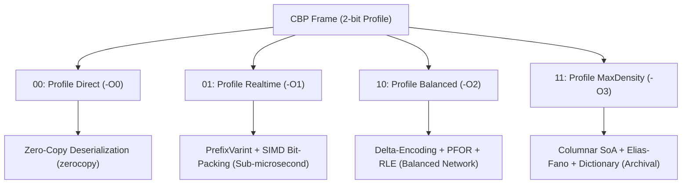

# RFC: Compact Binary Protocol (CBP) Wire Format Specification v1.0

- **Status**: Draft / Proposed
- **Version**: 1.0.0-draft
- **Authors**: GoldSrc Systems Architecture Team
- **Target Substrates**: `#![no_std]`, `stitch-core`, `zerocopy`

---

## 1. Abstract

Compact Binary Protocol (CBP) is an adaptive, domain-aware, contract-oriented
binary serialization and framing protocol engineered for ultra-low latency,
high-throughput, and extreme entropy density.

Unlike generic serializers (Protobuf, MessagePack, Bincode) that either
sacrifice compression ratio or incur heavy CPU decompression overheads,
CBP introduces:

1. **The First Bytes Axiom**: Compile-time static framing contracts
   deterministically inferred from a 2-byte prefix (`Magic` + `Version`),
   eliminating dynamic header self-description overhead.
2. **Layered Adaptive Profiles (-O0 to -O3)**: Compile-time and runtime
   selectable optimization pipelines targeting distinct operational regimes
   (Zero-Copy IPC, Sub-microsecond Game Ticks, Balanced Telemetry,
   and Shannon-Limit Archival).
3. **Monomorphic Traversal Pipelines**: Seamless integration with the Sewing
   Machine Architecture (`stitch-core`) for zero-allocation streaming
   transforms.

---

## 2. The First Bytes Axiom & Frame Geometry

Every CBP v1 frame begins with a fixed 2-byte prefix:

```text
 0                   1                   2                   3
 0 1 2 3 4 5 6 7 8 9 0 1 2 3 4 5 6 7 8 9 0 1 2 3 4 5 6 7 8 9 0 1
+-+-+-+-+-+-+-+-+-+-+-+-+-+-+-+-+-+-+-+-+-+-+-+-+-+-+-+-+-+-+-+-+
|  Magic (0xCB) | Version (0x01)|     Bit-Packed Frame Header   |
+-+-+-+-+-+-+-+-+-+-+-+-+-+-+-+-+-+-+-+-+-+-+-+-+-+-+-+-+-+-+-+-+
|       Payload Stream (Byte-Aligned or Block-Chunked)         ...
+-+-+-+-+-+-+-+-+-+-+-+-+-+-+-+-+-+-+-+-+-+-+-+-+-+-+-+-+-+-+-+-+
|                   Frame Footer (CRC32 / Hash)                 |
+-+-+-+-+-+-+-+-+-+-+-+-+-+-+-+-+-+-+-+-+-+-+-+-+-+-+-+-+-+-+-+-+
```

### 2.1 The Axiom Invariant

Upon observing `Magic == 0xCB` and `Version == 0x01`:

- The exact bitwise geometry of the Header and Footer is **statically
  immutable**.
- The parser does not need runtime length descriptors, dynamic TLV tags, or
  negotiation steps to decode the framing envelope.
- Header fields are bit-packed contiguously without byte-padding.

### 2.2 Version 1 Header Geometry (Sub-Byte Bitfield)

The v1 Frame Header consists of:

<!-- markdownlint-disable MD013 -->
| Field | Bit Width | Description |
| :--- | :--- | :--- |
| **Profile** | 2 bits | Optimization regime: `00` (-O0), `01` (-O1), `10` (-O2), `11` (-O3) |
| **Flags** | 4 bits | Frame attributes: `0x1` Compressed, `0x2` Chunked, `0x4` HasSchema, `0x8` Reserved |
| **Reserved** | 2 bits | Reserved for future minor flags (must be zero) |
| **PayloadLength** | 1..9 bytes | `PrefixVarint` encoding of uncompressed payload size |
| **SchemaFingerprint** | 0 or 8 bytes | Present only if `HasSchema == 1`. 64-bit truncated xxHash64 schema fingerprint |
<!-- markdownlint-enable MD013 -->

Total fixed header overhead for minimal frames: **3 bytes** (Magic + Version +
Profile/Flags + 1-byte PrefixVarint).

### 2.3 Version 1 Footer Geometry

The frame concludes with an integrity footer:

- **CRC32-Castagnoli** (4 bytes, little-endian): hardware-accelerated CRC
  (`_mm_crc32_u32` / ARM CRC) covering Header + Payload.

---

## 3. Layered Optimization Profiles (-O0 .. -O3)

CBP defines 4 standard operational profiles. The receiver dispatches each frame
to a monomorphic `stitch-core` traversal pipeline based on the 2-bit header:



### 3.1 Profile Direct (`-O0`)

- **Focus**: Minimum possible CPU latency, Zero heap allocation, Zero
  transformation.
- **Wire Representation**: Raw memory alignment complying with
  `zerocopy::FromBytes`.
- **Use Cases**: Local IPC, Shared Memory, In-Memory Caches.

### 3.2 Profile Realtime (`-O1`)

- **Focus**: High-frequency streaming, sub-microsecond latency, 0 branch
  mispredictions.
- **Wire Representation**:
  - `PrefixVarint` for variable integers (1-cycle branchless decode).
  - SIMD Bit-Packing across 128-bit / 256-bit vector registers.
- **Use Cases**: Game network snapshot ticks (64/128 tickrate), HFT market
  feeds.

### 3.3 Profile Balanced (`-O2`)

- **Focus**: Strong compression with lightweight CPU overhead.
- **Wire Representation**:
  - `Delta-Encoding` on monotone sequences.
  - `FastPFOR` (Patched Frame of Reference) bit-packing with exception lists.
  - `RLE` (Run-Length Encoding) for repeated values.
- **Use Cases**: Telemetry streams, mobile push notifications, general RPC.

### 3.4 Profile MaxDensity (`-O3`)

- **Focus**: Approaching the Shannon entropy limit for structured data.
- **Wire Representation**:
  - Automatic Struct-of-Arrays (SoA) columnar transposition.
  - `Elias-Fano` encoding for monotonically increasing integer sequences.
  - Deduplicated string/profile dictionary tables.
- **Use Cases**: Database distributions (`ipatlas`), cold storage, persistent
  log chunks.

---

## 4. Primitive Encoding Rules

### 4.1 Branchless `PrefixVarint`

Unlike traditional LEB128 (used in Protobuf) which uses the 8th bit of every
byte as a continuation flag—forcing CPU branch mispredictions in sequential
decode loops—CBP adopts **PrefixVarint**:

- The number of additional bytes is encoded in the count of trailing/leading
  zeros of the first byte.
- Decoding is performed via a single `count_trailing_zeros` or `leading_zeros`
  CPU intrinsic, followed by a masked shift.
- Zero loop iterations; zero branches.

### 4.2 ZigZag Signed Integer Mapping

Signed integers are mapped to unsigned integers to preserve small-magnitude
compression:

- `encode_zigzag32(n) = (n << 1) ^ (n >> 31)`
- `encode_zigzag64(n) = (n << 1) ^ (n >> 63)`

---

## 5. Security & Verification Invariants

1. **No Silent Error Suppression**: Truncated payloads, invalid bit widths, or
   checksum mismatches MUST immediately yield a typed `CbpError`.
2. **Buffer Bounds Immunity**: Readers must take continuous slices `&[u8]` and
   never advance beyond provided slice boundaries.
3. **No Unaligned Pointer Casts**: In `#![no_std]` and cross-architecture
   environments, all raw structure accesses must be verified through
   `zerocopy`.
